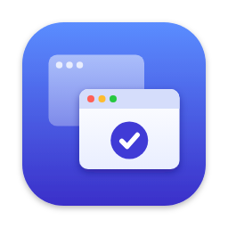

# WindowKeeper



Petite app de barre de menus pour macOS (Apple Silicon, macOS 13 ou plus récent) qui mémorise la disposition des fenêtres (position, taille, écran, bureau) pour chaque configuration d'écrans et la remet en place quand on branche ou débranche des écrans. SIP reste activé : l'app n'injecte rien dans le Dock.

## Installation

```
bash build.sh install
```

L'app est compilée hors d'iCloud Drive (`~/Library/Caches/WindowKeeper-build`), installée dans `~/Applications` puis lancée. Au premier lancement, accordez-lui l'autorisation dans Réglages Système > Confidentialité et sécurité > Accessibilité.

## Fonctionnement

- Chaque combinaison d'écrans (portable seul, portable + écrans du bureau, etc.) a sa propre disposition.
- La disposition est sauvegardée toutes les 30 secondes, donc la dernière sauvegarde avant un débranchement est celle qui sera restaurée au retour sur cette configuration.
- Quand les écrans changent, ou au réveil, l'app attend quelques secondes que macOS se stabilise puis restaure la disposition de la configuration courante.
- Les données sont dans `~/Library/Application Support/WindowKeeper/layouts.json`, le journal dans `~/Library/Logs/WindowKeeper.log`.

## Diagnostic

```
~/Applications/WindowKeeper.app/Contents/MacOS/WindowKeeper --diagnose
~/Applications/WindowKeeper.app/Contents/MacOS/WindowKeeper --selftest
```

`--selftest` ouvre une petite fenêtre de test et vérifie quelle méthode de changement de bureau macOS accepte sur cette machine.

## Limites connues

- Le changement de bureau d'une fenêtre repose sur des fonctions non documentées de macOS. Une mise à jour de macOS peut les casser ; dans ce cas l'app continue de restaurer positions, tailles et écrans, et le rapport de restauration liste les fenêtres restées sur le mauvais bureau.
- L'app ne crée pas de bureaux : si un bureau enregistré n'existe plus, il faut le recréer dans Mission Control.
- Les fenêtres en plein écran sont ignorées. Les fenêtres fermées ne sont pas rouvertes.
- L'app est signée sans certificat : après chaque recompilation, il faut supprimer puis redonner l'autorisation Accessibilité.
- Le changement de bureau a été vérifié sur macOS 26.7 (méthode « bridged »). Les méthodes de repli pour les versions plus anciennes ne sont pas testées.
- Dans Mission Control, décochez « Réarranger automatiquement les Spaces en fonction de votre utilisation la plus récente » pour que l'ordre des bureaux reste stable.
